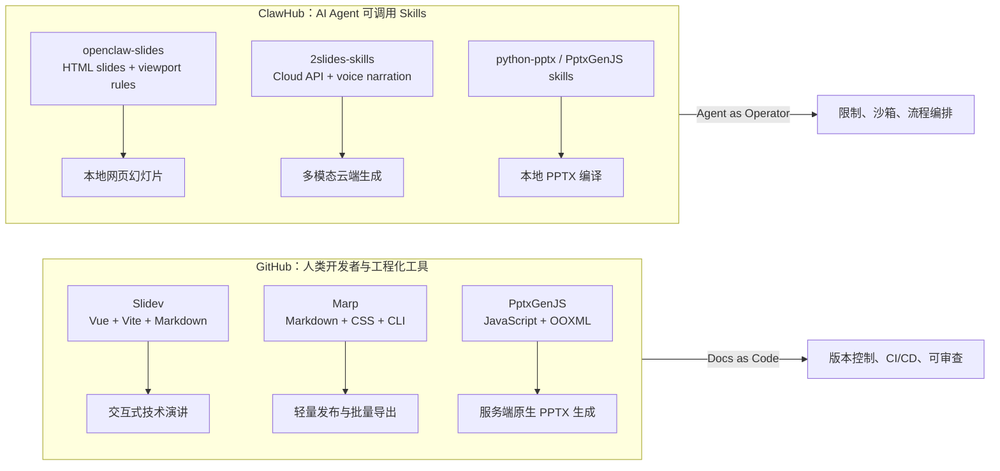
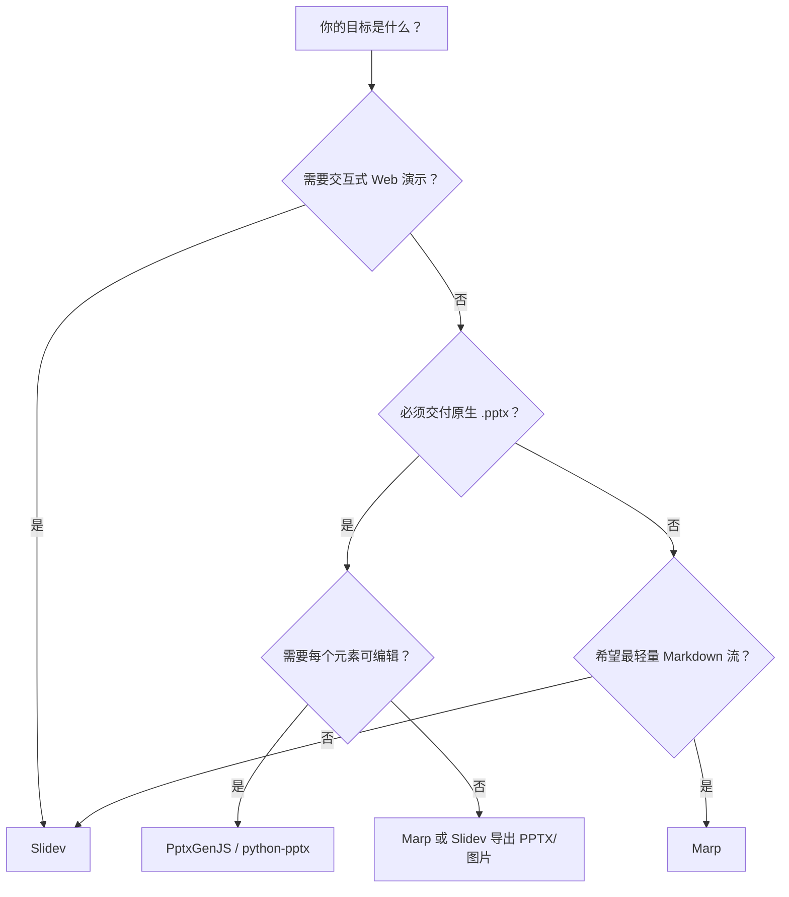
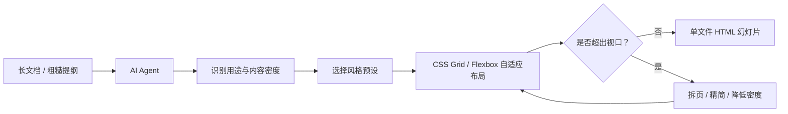
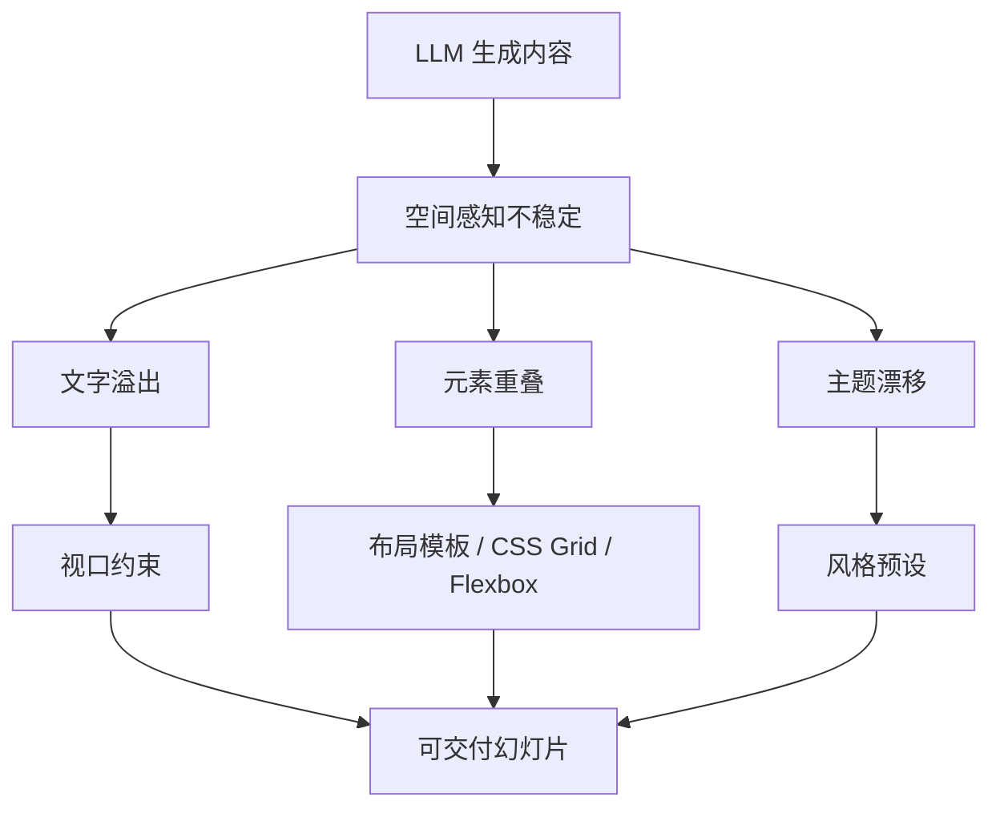

传统幻灯片制作长期依赖所见即所得的图形界面。它直观、低门槛，但一旦进入工程协作、版本控制、自动化批量生产，或者交给 AI Agent 生成，就会暴露出明显短板：二进制文件难 diff、模板复制容易漂移、批量改版成本高，最麻烦的是大模型并不擅长精确判断二维空间中的文字溢出和元素碰撞。

过去几年出现了两条路线。

一条来自 GitHub 生态：把幻灯片当作代码，用 Markdown、CSS、JavaScript 或 TypeScript 描述内容和结构，再编译成网页、PDF 或 PowerPoint。Slidev、Marp 和 PptxGenJS 是代表。

另一条来自 Agent Skill 生态：把幻灯片制作封装成可被智能体调用的技能包。ClawHub 上的 openclaw-slides、2slides-skills、openclaw-ppt-generator 等更关注“如何让 Agent 稳定地产出一份可用演示文稿”，而不是只给人类开发者一套 API。

这篇文章尝试把两条路线放在一起看：GitHub 工具解决的是“幻灯片如何工程化”，ClawHub Skills 解决的是“Agent 如何不把幻灯片做坏”。

## 一张图看双生态

## GitHub 生态：幻灯片即代码

GitHub 上的高关注度方案有一个共同点：它们都试图把幻灯片从 Office 二进制文件里“解放”出来，变成可以被 Git 管理、被脚本编译、被 CI/CD 发布的文本或代码。

### Slidev：最适合开发者演讲的 Web-native 框架

Slidev 的定位非常清晰：为开发者做演示。它使用扩展 Markdown 组织内容，底层基于 Vite 和 Vue，支持把 Vue 组件、实时交互、代码演示和主题系统嵌入幻灯片。按照 GitHub CLI 在 2026-05-22 的查询，`slidevjs/slidev` 已超过 4.6 万 Star，是这个方向里关注度最高的项目之一。

Slidev 的核心优势不是“写得比 PowerPoint 快”，而是它把前端开发能力带进了演示现场：

- Markdown 负责内容结构，适合 Git diff 和协作审查。
- Vue 组件负责交互，幻灯片可以直接嵌入动态图表、演示控件或小型 Web 应用。
- Vite 负责开发体验，修改内容后预览几乎即时刷新。
- Shiki 等工具提供高质量代码高亮，适合技术分享、框架发布、源码讲解。
- 导出体系支持 PDF、PPTX、PNG 或 Markdown，但 Slidev 官方也提醒：导出成 PPTX 时幻灯片通常以图片形式进入 PPTX，因此交互和可编辑文本会受限。

所以 Slidev 的最佳场景是技术会议、课程演示、代码走读、产品技术发布。它不适合那种“客户必须拿到完全可编辑 PowerPoint 文件、每个文本框都能改”的传统办公流。

### Marp：极简、可移植、适合自动化发布

Marp 的路线比 Slidev 更克制。它是 Markdown Presentation Ecosystem，强调“用接近标准 Markdown 的方式写幻灯片”。Marp 官方说明其生态包括 Marp CLI、Marp Core、Marpit 和 VS Code 插件；可以把 Markdown 转成 HTML、PDF、PowerPoint 和图片。

Marp 的工程优势在于简单：

- 输入是 Markdown，学习成本低。
- 输出是静态 HTML/CSS 或渲染后的 PDF/PPTX/图片。
- 主题和布局主要靠 CSS 与 Marp 指令。
- CLI 非常适合脚本化、批量生成和文档流水线。

如果 Slidev 更像“前端演示应用”，Marp 更像“Markdown 到幻灯片的可靠编译器”。它特别适合内部技术汇报、课程讲义、项目 README 转演示稿、自动化生成周报幻灯片等场景。

它的短板也来自克制：复杂交互、动态组件、深度自定义动画不是 Marp 的主战场。它更适合把内容快速、稳定、可移植地呈现出来。

### PptxGenJS：直接生成原生 Office XML

PptxGenJS 解决的是另一个问题：有些场景不需要网页幻灯片，而是必须产出 `.pptx`。例如企业报表系统、SaaS 导出、销售自动化、服务端 API 动态生成客户提案。

PptxGenJS 用 JavaScript/TypeScript API 直接构建 PowerPoint 的 OOXML 结构，生成兼容 Microsoft PowerPoint、Apple Keynote 和其他办公软件的 PPTX 文件。官方仓库 `gitbrent/PptxGenJS` 在 2026-05-22 查询时约 5.4k Star。

它的价值在于：

- 可以在 Node.js 服务端或浏览器端运行。
- 能生成原生形状、文本、表格、图片、图表和母版。
- 不依赖本机安装 PowerPoint。
- 更适合后端批量文档生成，而不是人手编辑一页页幻灯片。

但 PptxGenJS 也要求开发者理解 PPTX 的布局模型。它不像 Slidev/Marp 那样“写 Markdown 就能出片”，而是更接近“用代码写 Office 文档”。对 AI Agent 来说，如果没有模板约束和模块化拆分，直接让模型写复杂 PptxGenJS 代码，很容易出现位置错乱、尺寸计算错误和文件损坏。

## GitHub 工具对比

| 工具 | 输入模型 | 输出形态 | 最强场景 | 主要风险 |
| --- | --- | --- | --- | --- |
| Slidev | 扩展 Markdown + Vue 组件 | Web、PDF、图片、PPTX | 技术演讲、代码演示、交互课件 | PPTX 可编辑性有限，依赖前端构建栈 |
| Marp | Markdown + CSS 指令 | HTML、PDF、PPTX、图片 | 自动化发布、内部汇报、课程讲义 | 交互能力弱，复杂布局要写 CSS |
| PptxGenJS | JS/TS 声明式 API | 原生 PPTX | 动态报表、企业系统、后端导出 | 坐标和版式计算复杂，AI 直接写容易出错 |

## ClawHub 生态：让 Agent 稳定生成幻灯片

ClawHub 的核心不是某个渲染引擎，而是一种 Skill 分发方式。OpenClaw/ClawHub 的公开说明把 Skill 描述为围绕 `SKILL.md` 和支持文件组织的能力包；它可以包含脚本、参考文档、模板和运行说明。与 GitHub 框架相比，ClawHub 技能更强调“给 Agent 明确边界和流程”。

这很关键。人类开发者看到一个空白页面，会自觉控制信息密度；大语言模型看到一段长文，常常会把所有内容塞进一页。于是幻灯片 Skill 的第一原则不是炫技，而是限制：限制视口、限制字数、限制元素数量、限制主题空间、限制文件访问范围。

### openclaw-slides / frontend-slides：零依赖 HTML 幻灯片与视口约束

ClawHub 上的 openclaw-slides 页面描述它可以从零创建动画丰富的 HTML 演示，也可以把 PPT/PPTX 转成网页幻灯片；生成物是单个自包含 HTML 文件，不依赖 npm、构建工具或前端框架。页面还列出多个风格预设，例如 Bold Signal、Electric Studio、Notebook Tabs、Neon Cyber、Swiss Modern、Paper & Ink 等。

它最值得注意的是“视口防溢出”约束：每页必须刚好适配浏览器视口，不允许内部滚动。ClawHub 页面明确写到“Every slide MUST fit exactly within the viewport. No scrolling within slides, ever.” 并给出内容密度上限，比如内容页 4-6 个 bullet、特性网格最多 6 张卡片、代码页 8-10 行代码。

这不是审美建议，而是给 Agent 的工程护栏。它把“不要把一页写满”变成了硬规则。

这种 Skill 的价值不在于“HTML 比 PowerPoint 高级”，而在于它把审美选择、空间约束、图片处理、导航交互和内联编辑统一成一个 Agent 可执行流程。它适合销售提案、内部宣讲、教学演示、快速 pitch deck，尤其适合“先要一个可看的版本，再微调”的场景。

### 2slides-skills：云端多模态生成与配音合成

2slides-skills 走的是另一条路线：它不是本地 HTML 编译器，而是把 Agent 接到 2slides 云端 API。ClawHub 页面显示，它支持基于内容生成、参考图风格匹配、文档总结、主题搜索和配音生成；还提供 MCP 接入方式，包括 Streamable HTTP 和本地 npm stdio。

这个 Skill 的关键能力有三类：

- `slides_generate`：根据内容生成演示。
- `slides_create_like_this`：根据参考图片生成相似风格。
- `themes_search`：搜索主题。
- `jobs_get`：检查异步任务状态。

它的差异化能力是 voice narration。ClawHub 页面写明支持 30 个 voice options、19 种语言和 multi-speaker mode；下载归档可以包含 PNG 页面、WAV 音频和文字 transcript。

但这类云端 Skill 也带来成本和合规问题。ClawHub 页面列出的点数机制是：Fast PPT 10 credits/page，Nano Banana 1K/2K 100 credits/page，Nano Banana 4K 200 credits/page，Voice Narration 210 credits/page，Download Export 免费。它适合多语种课程、出海营销、自动化内容生产，但不适合高度敏感、不能上传到外部 API 的材料。

### 本地 PPTX Skills：python-pptx 与模块化 PptxGenJS

ClawHub 上也有一类更朴素的本地 PPT 技能，例如 openclaw-ppt-generator、dragon-ppt-maker、office-generator-py、ppt-mcp-server 等。它们通常基于 `python-pptx`、Pillow 或类似本地库，把 Agent 的结构化输入转换为 `.pptx` 文件。

这类 Skill 的优势是安全和可控：不需要外部 API，能在内网或离线环境中运行，适合高密级报表、内部周报、结构化汇报。缺点是审美和灵活性通常弱于网页幻灯片或云端设计引擎；如果没有企业模板和严格布局规则，输出会比较“办公默认风”。

本地 PPTX Skill 的演进方向，是让 Agent 不直接写一整份大文件，而是把每页拆成独立模块，再由统一编译器合并。这和软件工程里的模块化编译很像：一页坏了，不应该污染整份演示。

## ClawHub Skills 对比

| Skill / 类型 | 执行环境 | 主要输出 | 适合场景 | 主要代价 |
| --- | --- | --- | --- | --- |
| openclaw-slides | 本地 Agent + HTML/CSS + 可选 Python 图片处理 | 单文件 HTML 幻灯片 | 快速提案、教学、销售材料、可视化探索 | 非传统 PPTX，需接受网页交付形态 |
| frontend-slides | 本地 HTML 幻灯片 Skill | 单文件 HTML | 非设计人员快速生成视觉稿 | 与 openclaw-slides 路线接近，需关注版本差异 |
| 2slides-skills | 外部 API + 可选 MCP | PNG/PDF/ZIP/音频等 | 多语种、配音、参考图风格复制 | 需要 API key、点数成本和数据外传评估 |
| openclaw-ppt-generator | 本地 python-pptx | 标准 PPTX | 离线、内网、简单汇报 | 视觉设计能力有限 |
| python-pptx / PptxGenJS 类 Skills | 本地脚本或 MCP 工具 | 标准 PPTX | 企业报表、批量生成、模板化输出 | 需要模板规范，否则排版不稳 |

## 底层逻辑：为什么 Agent 做 PPT 需要“限制”

大语言模型擅长结构化文本，但不擅长精确版式。它很难稳定估算：某段中文在 24px 字号下占多少宽度，一张图在 16:9 页面里会不会和图例重叠，六张卡片加一个标题还能不能在 100vh 内呼吸。

因此，Agent PPT Skills 的关键不是“让模型自由发挥”，而是把自由度收窄到可编译的设计空间。

这也是 openclaw-slides 这类 Skill 强调 `100vh / 100dvh`、内容密度上限、图片尺寸处理和 CSS 预设的原因。它们不是为了限制创意，而是为了让 Agent 的输出从“可能很好看”变成“大概率不会坏”。

## 从 Office 文件迁移到 Web 标准

Slidev、Marp 和 openclaw-slides 共同指向一个趋势：幻灯片越来越像网页。

这带来三个好处。

第一，渲染环境更统一。只要浏览器能跑，演示就能打开，不再强依赖某台机器上的 Office 版本、字体和插件。

第二，协作方式更工程化。Markdown、CSS、JS 都是文本，天然适合 Git、Pull Request、CI/CD 和自动化检查。

第三，Agent 更容易介入。相比二进制 PPTX，HTML 和 Markdown 更容易被模型读取、修改、拆分和验证。

但 PowerPoint 并不会消失。企业场景仍然强依赖 `.pptx`，因为它承载了模板、审批、客户交付和编辑习惯。未来更现实的格局是双轨并存：

- Web-native 幻灯片负责快速生成、交互演示、在线传播。
- PPTX 负责客户交付、企业模板、离线编辑和正式归档。

## 落地建议

如果你要做技术会议、开发者培训、框架发布，优先选择 Slidev。它能把代码、交互和演讲节奏结合起来，最能体现“幻灯片即前端应用”的优势。

如果你要做轻量内部汇报、课程讲义、项目文档自动转演示，优先选择 Marp。它最稳、最轻，也最适合放进 CI 流水线。

如果你要在企业系统里批量生成原生 PowerPoint，比如销售周报、数据报表、客户方案，优先选择 PptxGenJS 或 python-pptx，并且一定要先定义母版和布局规范。

如果你希望 Agent 根据一段材料快速生成一套好看的网页幻灯片，openclaw-slides/frontend-slides 这种本地 HTML Skill 更合适。它的价值在于风格预设和视口护栏。

如果你需要多语种配音、参考图风格迁移、自动化课程视频素材，2slides-skills 更合适，但要先评估 API 成本和数据合规。

如果内容是内网高密材料，优先选本地 Skill，不要把文档交给云端生成服务。

## 结论

GitHub 生态和 ClawHub 生态的差异，可以概括为一句话：

GitHub 工具把幻灯片变成代码，ClawHub Skills 把幻灯片制作变成 Agent 可执行的受控流程。

前者强调可维护性、可组合性、可发布性；后者强调约束、沙箱、自动化和稳定交付。真正成熟的方案不会二选一，而是把两者组合起来：用 GitHub 工具提供可审查的生成底座，用 Agent Skills 封装任务流程和设计护栏。

未来的 PPT 制作，可能不再是“打开 PowerPoint 逐页拖拽”，而是“给 Agent 一份结构化材料，让它在受限的设计系统中编译出演示文稿”。人类仍然负责判断观点、叙事和审美方向；机器负责把结构稳定地落到页面上。

## 资料来源

- [Slidev 官方文档：Why Slidev](https://sli.dev/guide/why)
- [Slidev 官方文档：Exporting](https://sli.dev/guide/exporting.html)
- [Marp 官方网站](https://marp.app/)
- [Marp GitHub repository](https://github.com/marp-team/marp)
- [Marp CLI repository](https://github.com/marp-team/marp-cli)
- [PptxGenJS GitHub repository](https://github.com/gitbrent/PptxGenJS)
- [ClawHub repository](https://github.com/openclaw/clawhub)
- [openclaw-slides on ClawHub](https://clawhub.ai/skills/openclaw-slides)
- [Frontend Slides on ClawHub](https://clawhub.ai/skills/frontend-slides)
- [2slides-skills on ClawHub](https://clawhub.ai/javainthinking/2slides-skills)
- [openclaw-ppt-generator on ClawHub](https://clawhub.ai/xiangzhanyou/openclaw-ppt-generator)
